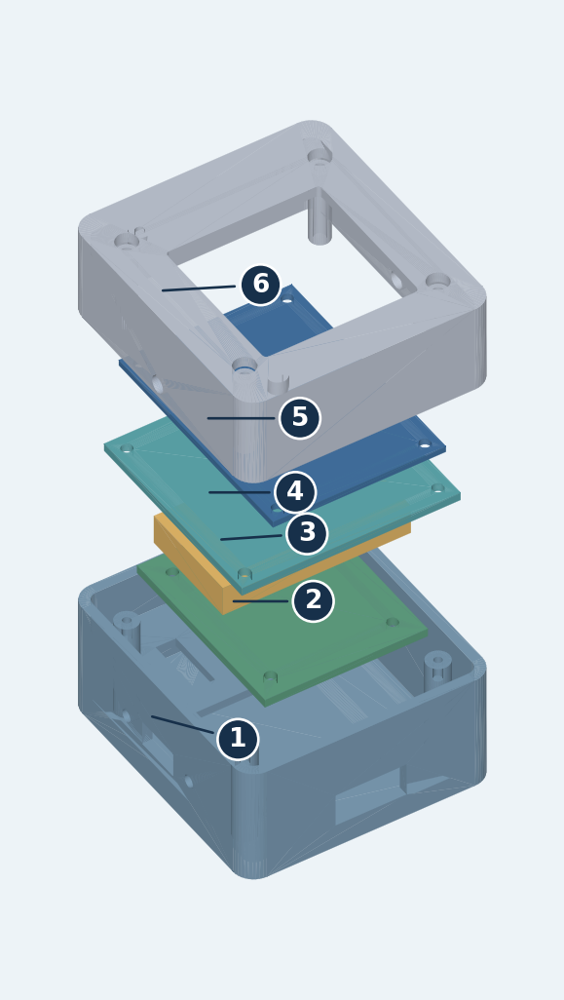

# Paky76 Mini A5

Dispositivo portatile con due tasti laterali e un volto animato su **OLED SH1107G-02 da 1,5″, 128 × 128, I²C a 4 pin**. La A5 usa la **PCB principale A4** e il **frontale A1** già ordinati nella configurazione A4.1. Firmware, cablaggio, scocca e figure sono riferiti all'OLED quadrato.

## Documentazione

| Documento | Contenuto |
| --- | --- |
| [Manuale illustrato PDF](Documentazione/Paky76-Mini-A5-Manuale-Assemblaggio.pdf) | Stampa, montaggio, orientamento e collaudo |
| [Schema elettrico A3 · pagina unica](Documentazione/Paky76-Mini-A5-Schema-Elettrico.pdf) | Simboli elettrici, alimentazione, pull-up, pulsanti e OLED |
| [Tavola di cablaggio A3](Documentazione/Paky76-Mini-A5-Schema-Cablaggio-Completo.pdf) | Cablaggio tra i moduli con pin e segnali numerati |
| [Schemi di collegamento PDF](Documentazione/Paky76-Mini-A5-Schemi-Collegamento.pdf) | PCB, OLED, interruttore e batteria |
| [Datasheet PDF](Documentazione/Paky76-Mini-A5-Datasheet.pdf) | Specifiche e tavole quotate |
| [Figure e quote](Documentazione/Figure/) | Esploso, guscio, cornice, finestra, fori OLED e profilo |
| [Guida operativa](LEGGIMI.md) | Stampa, fissaggi, cablaggio, firmware e prove |

## Hardware e distinta per un dispositivo

| Qtà | Parte | Specifica |
| ---: | --- | --- |
| 1 | [Principale A4](Principale/) | 32 × 39 mm; USB-C, ingresso LiPo e pull-up I²C |
| 1 | [Frontale A1](Frontale/) | 43 × 42 mm; due tasti laterali e uscita OLED |
| 1 | U1 | Seeed XIAO ESP32-S3 113991114, C20467913 |
| 2 | J1 | JST SH 6 poli BM06B-SRSS-TB, C160392 |
| 1 | J2 frontale | JST SH 4 poli BM04B-SRSS-TB, C160390 |
| 2 | R1/R2 | 4,7 kΩ SMD 0603, C99782 |
| 2 | SW1/SW2 | Panasonic EVQP7A01P, C79167 |
| 1 | S1 | Nidec MFS201N-Z, a slitta sul fianco |
| 1 | OLED | SH1107G-02; PCB 34 × 47 mm; spessore massimo dichiarato 11,3 mm; area visibile 28,86 × 28,86 mm |
| 1 | Batteria | LiPo protetta 1S, 3,7 V nominali, 4,2 V a fine carica. Riferimento 350 mAh |
| 1 ciascuno | Cavetti | JST SH 6 vie pin per pin, JST SH 4 vie con fili lato OLED, contropresa batteria, cavo USB-C dati |
| Secondo montaggio | Fissaggi e accessori | Viti M2 da scegliere a secco, guaina isolante, ritenzione morbida cella, antenna XIAO se assente |

I [file JLCPCB](JLCPCB/) contengono Gerber, BOM e CPL per ciascuna scheda. Per PCB nudi, U1 richiede anche la saldatura dei due pad batteria sotto il modulo. Per PCBA, controllare in anteprima orientamento, componenti e montaggio.

## Cablaggio e alimentazione

**J1 principale ↔ J1 frontale**, pin per pin. 1 GND, 2 3V3, 3 SDA/GPIO5, 4 SCL/GPIO6, 5 SW1/GPIO2, 6 SW2/GPIO1. I pulsanti sono attivi bassi.

| J2 frontale | Funzione | Pin OLED secondo il disegno |
| ---: | --- | ---: |
| 1 | GND | 2 |
| 2 | 3V3 verso VCC | 1 |
| 3 | SDA | 4 |
| 4 | SCL | 3 |

Il testo commerciale e il disegno OLED riportano numerazioni di alimentazione diverse. **Seguire le serigrafie sul modulo ricevuto e collegare per segnale.** Passo JST SH 1,0 mm; lato OLED 2,54 mm. Vedere il [pinout](Cablaggio/Pinout-OLED-SH1107.md).

Il **J2 della principale** porta il positivo LiPo sul pin 1 VBAT attraverso S1 e il negativo diretto sul pin 2 GND. La prima accensione si fa via USB con batteria scollegata. Per ricaricare, portare S1 su ON. Per togliere tutta l'alimentazione, mettere S1 su OFF e scollegare USB-C.

## Scocca, montaggio e firmware

1. La scocca misura **49 × 54 × 41,6 mm**, escluse le sporgenze, e **61,5 mm** in lunghezza con occhiello. Finestra **30,4 × 30,4 mm**, centrata 3 mm verso USB-C nel CAD. Interasse nominale di fissaggio OLED **29 × 42 mm**, da confrontare con il campione.
2. In Cura importare gli [STL A5](Meccanica/) al 100%. Stampare un guscio, una cornice e due copritasti. Confrontare la dima OLED con il modulo reale prima della stampa definitiva. Il sorgente OpenSCAD è nella stessa cartella.
3. Installare S1 e la principale con USB-C opposta all'occhiello. Verificare a secco ripiano, batteria, frontale, copritasti e OLED. Montare secondo le figure, con il vetro verso la finestra e J2 del frontale verso USB-C.
4. Installare il core esp32 di Espressif e U8g2 in Arduino IDE, selezionare XIAO_ESP32S3 e usare lo [sketch A5](Firmware/Paky76MiniSH1107/Paky76MiniSH1107.ino). Il firmware cerca 0x3C e 0x3D a 100 kHz, anima il volto e risveglia il display con uno dei tasti dopo lo spegnimento per inattività. Monitor seriale a 115200 baud.
5. Verificare display, tasti e continuità prima di collegare la LiPo. Sul campione controllare passaggio dei cavi, assenza di compressione sulla cella, ricarica e temperatura con la scocca chiusa.

## Stato delle prove

I [rapporti](Verifiche/) registrano l'identità byte per byte delle PCB e dei file JLCPCB con la A4.1, il controllo delle mesh STL e la simulazione host della logica firmware. **Compilazione per la XIAO e collaudo fisico restano da eseguire.** Le quote di montaggio OLED e la corsa dei copritasti vanno verificate sul primo campione.
