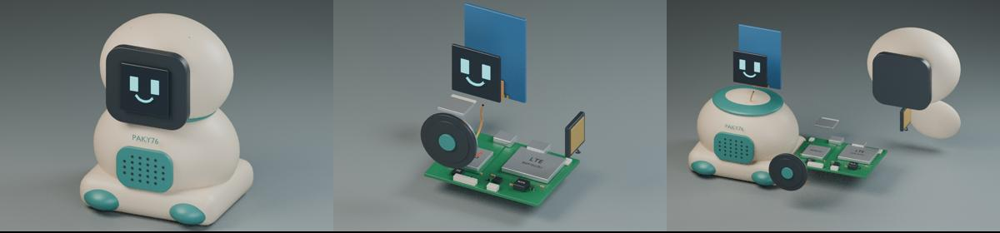

# Paky76 Rev.B — pupazzetto parlante

Paky76 è un personaggio da scrivania con volto animato su ST7789, microaltoparlante nel petto e accesso iniziale da USB-C o Wi-Fi. La Rev.B amplia la Rev.A con audio, alimentazione dedicata e connettività cellulare. Questo pacchetto contiene il progetto di integrazione, lo studio volumetrico OpenSCAD e il firmware sorgente della configurazione. La Rev.B elettrica deve essere disegnata in KiCad e collaudata.

## Prima configurazione

1. Compilare il firmware in `firmware/` con `pio run` e programmarlo su una ESP32-S3 con USB nativa. Verificare il cablaggio ST7789 della Rev.A prima di collegare il display.
2. **USB** — collegare un cavo dati. Da `dashboard/` avviare `python3 -m http.server 8765 --bind 127.0.0.1`. Aprire `http://localhost:8765` da Chrome o Edge desktop con Web Serial. Premere **Collega USB** e scegliere la porta USB Serial/JTAG di Paky76. Chiudere il monitor seriale se occupa la porta.
3. **Wi-Fi, prima accensione** — collegarsi alla rete `Paky76-XXXX` con il codice riportato sul display oppure leggibile via USB. Aprire `http://192.168.4.1/setup`. Il nome utente è `paky` e la password è il codice del dispositivo.
4. Impostare SSID, password Wi-Fi, APN e volume. Il Wi-Fi è facoltativo. La pagina indica lo stato e l’indirizzo IP. Quando il dispositivo entra nella rete Wi-Fi locale, la dashboard si raggiunge da un dispositivo sulla stessa rete aprendo `http://<IP-di-Paky76>/setup`. La rete temporanea scade dopo 20 minuti e si può riattivare via USB.
5. **Prova altoparlante** riproduce un tono via I²S sui GPIO4/5/6. Serve un amplificatore collegato, uno speaker idoneo e un'alimentazione dimensionata. Il tono serve a collaudare il percorso audio.

Via Wi-Fi il firmware usa HTTP Basic su rete locale. Usare la rete temporanea protetta o una LAN fidata. L'interfaccia non attiva esposizione Internet, server LTE o inoltro porte. Il firmware salva le impostazioni in NVS; la release richiede cifratura della memoria e gestione separata delle eventuali credenziali del servizio vocale. La risposta di stato non restituisce la password Wi-Fi. Il codice di configurazione viene mostrato fisicamente sul display durante la configurazione e restituito via USB.

## Stato di consegna

| Funzione | Stato |
|---|---|
| Volto, dashboard USB/Wi-Fi, NVS e tono speaker | Sorgente implementato. Sintassi JS verificata. Flash, build PlatformIO e prove su scheda da eseguire. |
| Parlato italiano | Percorso audio previsto. Integrare un servizio TTS e riproduzione PCM, poi sincronizzare le espressioni del volto. Per il funzionamento senza Internet prevedere frasi registrate in flash. |
| LTE autonomo | Architettura, APN e pin proposti. Modem, driver di registrazione rete e sessione dati da integrare. |
| Carrozzeria | Studio volumetrico con ingombri e separazione dei sottosistemi. Dettagliare fissaggi, volume acustico e antenna sul campione. |
| Produzione | Richiede nuovo schema e PCB Rev.B, DFM e prove fisiche. |

## Verifica e anteprima

Il workflow **Rev.B engineering validation** ripete i test della dashboard, la generazione del modello OpenSCAD e la compilazione ESP32-S3. Gli esiti e i requisiti per il rilascio sono descritti in [PREPRODUZIONE.md](PREPRODUZIONE.md).

Vedi [la specifica hardware](hardware-revb.md) e [lo studio volumetrico](Paky76-RevB-ingombri.scad).
